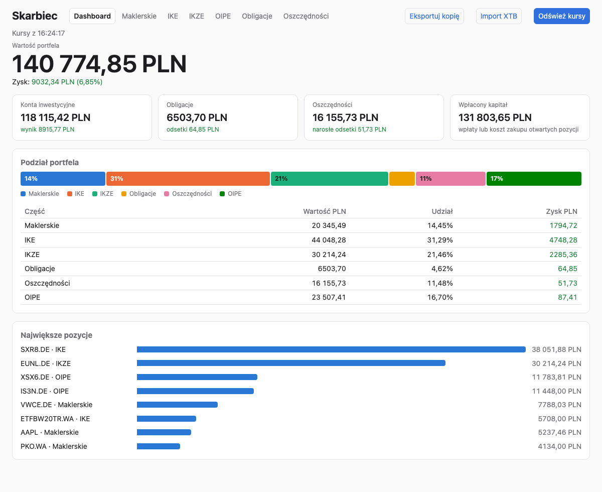
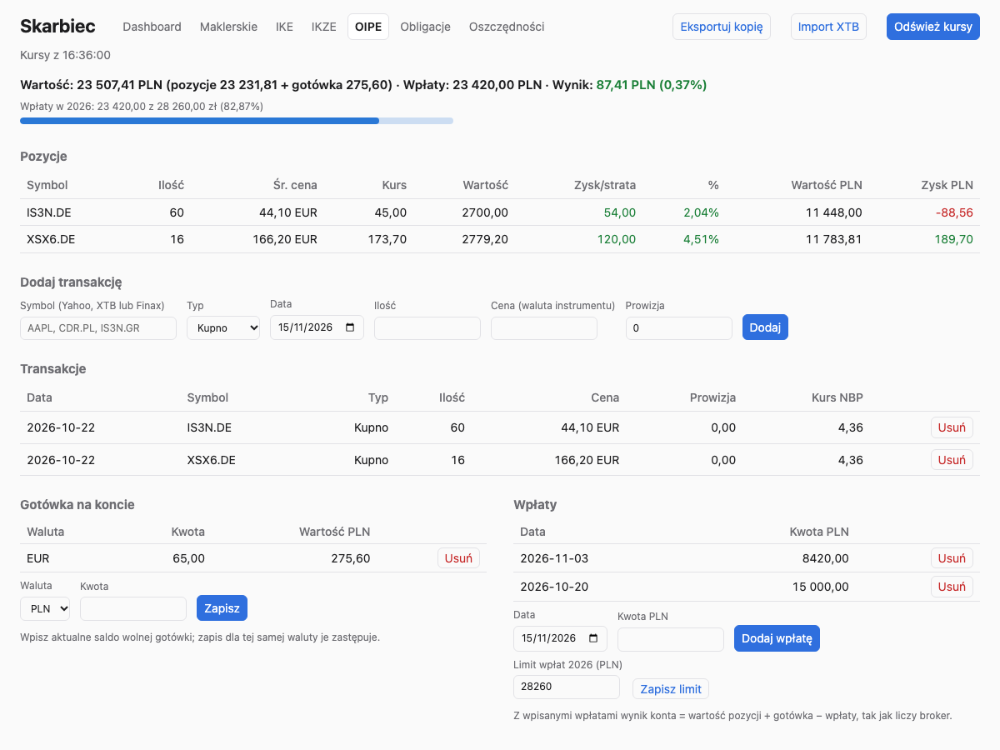
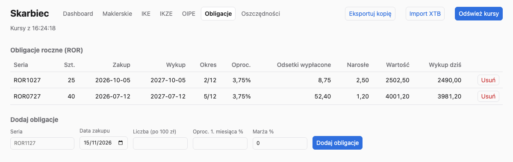
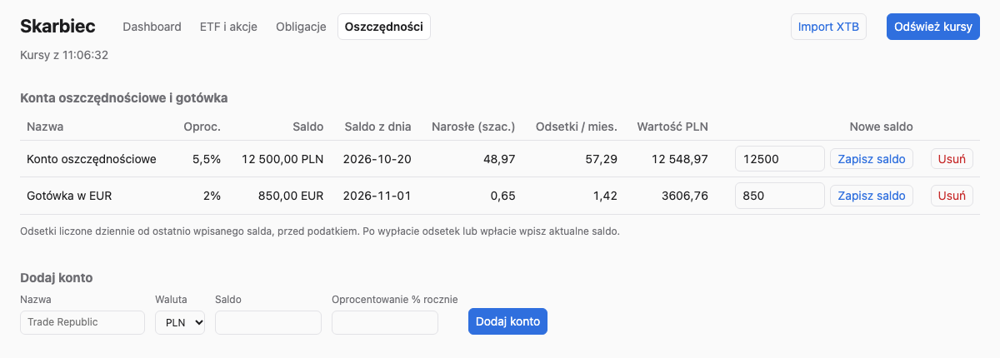

# Skarbiec

[](https://github.com/dbackowski/skarbiec/actions/workflows/tests.yml)

Desktopowa aplikacja do śledzenia domowego majątku: ETF-y i akcje na kontach maklerskich, IKE, IKZE i OIPE,
obligacje skarbowe ROR i konta oszczędnościowe. Wartości są przeliczane na PLN i zebrane na jednym
dashboardzie. Historię z XTB można zaimportować bezpośrednio z raportu xStation.

Dane zostają na komputerze, w jednym pliku JSON. Aplikacja nie ma kont, serwera ani logowania do brokera.


> Zrzuty pokazują dane demonstracyjne z losowymi wartościami.

## Funkcje

**Dashboard.** Łączna wartość i zysk, kafelki per klasa aktywów, podział portfela (Maklerskie / IKE / IKZE /
obligacje / oszczędności / OIPE) i największe pozycje. Przypomina o obligacjach, których wykup wypada w ciągu
30 dni, i o już wykupionych. Działa w trybie jasnym i ciemnym.



**Konta inwestycyjne: Maklerskie, IKE, IKZE i OIPE.** Każde konto ma własną zakładkę:

- pozycje ze średnią ceną zakupu i zyskiem w walucie instrumentu oraz w PLN,
- transakcje kupna i sprzedaży; formularz w zakładce dodaje do tego konta,
- wolną gotówkę w dowolnej walucie; powiększa wartość konta.

Pozycje są rozdzielone między konta: nie da się sprzedać z IKE jednostek kupionych na koncie maklerskim.
Symbol można wpisać tak, jak pokazuje go broker: w formacie Yahoo (`CDR.WA`), XTB (`CDR.PL`) albo Finax
(`IS3N.GR` → `IS3N.DE`).

**OIPE (Finax).** Finax nie ma eksportu, więc transakcje z listy na stronie Finax wpisuje się ręcznie w zakładce
OIPE: ticker, data, liczba jednostek i cena w EUR. Finax sam wymienia złotówki na euro po swoim kursie, dlatego
OIPE ma dodatkowo:

- wpłaty w PLN: wynik konta liczy się wtedy tak jak w Finax: wartość pozycji + gotówka − wpłaty, i zgadza się
  z Finax z dokładnością do kursu euro, po którym Finax wycenia portfel,
- wolną gotówkę w EUR, której Finax jeszcze nie zainwestował,
- pasek wykorzystania rocznego limitu wpłat (2026: 28 260 zł; limit można zmienić w zakładce).

Wynik pojedynczych ETF-ów w tabeli pozycji jest przybliżony (koszt po kursie NBP z dnia transakcji). Konta
z XTB nie potrzebują wpłat: import bierze kurs wymiany, po którym XTB faktycznie przewalutował złotówki.



**Obligacje ROR.** Odsetki liczone według listu emisyjnego: pierwszy miesiąc stały, potem stopa
referencyjna NBP plus marża, okresy od dnia zakupu. Tabela pokazuje odsetki wypłacone, narosłe i kwotę przy
wcześniejszym wykupie (po opłacie 0,50 zł).



**Oszczędności.** Konta oszczędnościowe i gotówka w PLN, EUR lub USD z szacunkiem narosłych odsetek.



**Import z XTB.** Przycisk „Import XTB” w nagłówku wczytuje raporty historii z xStation (XLSX, kilka plików
naraz). Przed zapisem pokazuje podsumowanie zmian.

## Uruchomienie

Wymagania: [Rust](https://rustup.rs) (w tym repo przez asdf, wersja w `.tool-versions`), Node.js
i Xcode Command Line Tools na macOS.

```sh
npm install
npm run tauri dev      # tryb deweloperski
npm run tauri build    # aplikacja .app / .dmg w src-tauri/target/release/bundle
npm run test:all       # wszystkie testy (JS + Rust)
```

## Instalacja i aktualizacja

Aplikację buduje się lokalnie i kopiuje do folderu Aplikacje. Aktualizacja to te same kroki na nowszym
kodzie.

```sh
git pull                 # najnowszy kod (przy pierwszej instalacji pomiń)
npm ci                   # zależności dokładnie z package-lock.json
npm run test:all         # nie instaluj wersji, w której testy nie przechodzą
npm run tauri build      # kilka minut przy pierwszym budowaniu
```

Następnie zamknij działający Skarbiec (Cmd+Q) i podmień aplikację:

```sh
rm -rf /Applications/Skarbiec.app
ditto src-tauri/target/release/bundle/macos/Skarbiec.app /Applications/Skarbiec.app
```

- Dane (`~/Library/Application Support/pl.local.skarbiec/skarbiec.json`) leżą poza aplikacją, więc
  podmiana ich nie dotyka. Przed większą aktualizacją możesz i tak kliknąć „Eksportuj kopię”.
- Aplikacja zbudowana na własnym komputerze uruchamia się bez ostrzeżeń macOS. Ostrzeżenie Gatekeepera
  pojawia się dopiero przy aplikacji pobranej z internetu, bo nie jest podpisana kontem Apple Developer.
- Build tworzy też instalator `.dmg` w `src-tauri/target/release/bundle/dmg/`, przydatny do przeniesienia
  aplikacji na inny Mac.

### Gotowa paczka z GitHuba

Workflow „Release” (`.github/workflows/release.yml`) buduje aplikację na trzy systemy i dołącza paczki
do jednego szkicu wydania na GitHubie. Paczki powstają dopiero, gdy przejdą testy.

| System | Paczki |
|---|---|
| macOS (Apple Silicon) | `.dmg`, `.app.tar.gz` |
| Windows | `.msi`, `.exe` (instalator NSIS) |
| Linux | `.AppImage`, `.deb`, `.rpm` |

1. Podnieś wersję w `src-tauri/tauri.conf.json`, `package.json` i `src-tauri/Cargo.toml`, zrób commit.
2. Wypchnij tag z tą wersją: `git tag v1.0.0 && git push origin v1.0.0`
   (albo uruchom workflow ręcznie w zakładce Actions; nazwa wydania bierze się z wersji aplikacji).
   Tag niezgodny z wersją aplikacji zatrzymuje budowanie.
3. Sprawdź szkic w zakładce Releases i opublikuj go.

Paczki nie są podpisane certyfikatem, więc przy pierwszym uruchomieniu system ostrzega:

- **macOS:** prawy przycisk na `Skarbiec.app` → Otwórz → Otwórz, albo
  `xattr -dr com.apple.quarantine /Applications/Skarbiec.app`.
- **Windows:** w oknie SmartScreen „Więcej informacji” → „Uruchom mimo to”.
- **Linux:** zainstaluj `.deb` / `.rpm` albo nadaj plikowi `.AppImage` prawo wykonywania (`chmod +x`).

## Testy

```sh
npm test               # testy jednostkowe + testy interfejsu w Chrome
npm run test:rust      # testy części w Ruście
npm run test:all       # jedno i drugie
```

- **Jednostkowe** (`test/*.test.js`, `node --test`): pozycje i średnia cena, wycena w PLN z kursami walut,
  obligacje ROR, oszczędności, podział portfela, pobieranie kursów z Yahoo/NBP (z podstawionym `fetch`),
  czytnik XLSX, parser raportów XTB i budowanie importu.
- **Interfejs** (`test/e2e.test.js`): prawdziwy interfejs z `src/` w Google Chrome (przez `playwright-core`,
  bez pobierania przeglądarki). Tauri jest zastąpione atrapą z plikiem danych w pamięci i stałymi kursami,
  zegar ustawiony na 15.11.2026. Sprawdza dashboard co do grosza, formularze, usuwanie, zakładki, tryb
  bez połączenia, import XTB z kopią zapasową, eksport i zachowanie przy nieczytelnym pliku danych.
- **Rust** (`src-tauri/src/lib.rs`): odczyt i atomowy zapis pliku danych, odrzucanie niepoprawnego JSON,
  nazwy kopii zapasowych i usuwanie najstarszych.
- **Pliki XTB w testach** (`test/fixtures/*.xlsx`) mają wymyślone dane w strukturze prawdziwych raportów.
  Generuje je `python3 test/fixtures/make_xtb_fixtures.py`.

Testy interfejsu wymagają zainstalowanej przeglądarki Google Chrome.

Na GitHubie testy uruchamiają się automatycznie przy każdym `push` na `main`, przy każdym pull requeście
i przed budowaniem wydania (`.github/workflows/tests.yml`, runner Ubuntu).

## Import z XTB

1. W xStation otwórz **Historię**, ustaw zakres dat od otwarcia rachunku i pobierz raport w formacie Excel.
   XTB tworzy osobny plik dla każdego rachunku (np. `PLN_…`, `EUR_…`, `IKE_…`, `IKZE_…`).
2. W Skarbcu kliknij **Import XTB** i zaznacz wszystkie pliki.
3. Sprawdź podsumowanie i kliknij **Importuj**.

Zasady importu:

- Typ konta i waluta są rozpoznawane z zawartości raportu. Symbole XTB są zamieniane na symbole Yahoo (`.PL` → `.WA`, `.US` → bez końcówki, `.UK` → `.L`).
- Aktualne pozycje pochodzą z arkusza *Open Positions*, a sprzedaże z *Closed Positions*.
- Koszt w PLN liczony jest po kursie, który XTB faktycznie pobrało przy zakupie (z *Cash Operations*). Dzięki temu koszt zgadza się z XTB co do grosza.
- Ponowny import tego samego rachunku zastępuje wcześniej zaimportowane transakcje.
- Ręczne transakcje tych samych symboli na tym samym koncie są usuwane, żeby nie liczyć ich podwójnie. Podsumowanie pokazuje je przed potwierdzeniem.
- Nie są importowane: dywidendy, odsetki od wolnych środków, wpłaty i pozycje krótkie (SELL).

## Skąd biorą się liczby

| Co | Źródło / metoda |
|---|---|
| Kursy instrumentów | Yahoo Finance (nieoficjalny endpoint `v8/finance/chart`). Cena ostatniej transakcji, więc może się różnić od wyceny XTB, która liczy po cenie sprzedaży (bid). |
| Kursy walut | NBP, tabela A. Dla transakcji kurs z dnia zakupu, do wyceny kurs bieżący. |
| Pozycje | Metoda średniej ceny zakupu. PIT-38 wymaga FIFO, więc nie używaj tych liczb do rozliczenia podatku. |
| Obligacje ROR | List emisyjny 104/2026 i archiwum stóp procentowych NBP. Kwoty przed podatkiem Belki. |
| Oszczędności | Odsetki proste, dzienne, od ostatnio wpisanego salda, przed podatkiem. Po kapitalizacji wpisz aktualne saldo. |

## Dane i kopia zapasowa

Wszystko jest w jednym pliku `skarbiec.json` w katalogu danych aplikacji:

| System | Katalog |
|---|---|
| macOS | `~/Library/Application Support/pl.local.skarbiec/` |
| Windows | `%APPDATA%\pl.local.skarbiec\` |
| Linux | `~/.local/share/pl.local.skarbiec/` |

Zapis jest atomowy (plik tymczasowy + zmiana nazwy), więc awaria w trakcie zapisu nie uszkodzi danych.
W tym samym pliku zapisywane są ostatnio pobrane kursy, żeby aplikacja działała bez połączenia.

Kopie zapasowe:

- **Automatycznie przed każdym importem z XTB** w `pl.local.skarbiec/backups/`. Zostaje 20 najnowszych kopii.
  Jeśli kopii nie da się zrobić, import zostaje przerwany.
- **Ręcznie** przyciskiem „Eksportuj kopię”, który zapisuje `skarbiec-kopia-<data>.json` w folderze Pobrane.

Przywracanie: zamknij aplikację i skopiuj wybraną kopię w miejsce `skarbiec.json`.

## Bezpieczeństwo

- Brak backendu i otwartych portów. Interfejs rozmawia z Rustem przez IPC Tauri.
- Aplikacja może się łączyć tylko z Yahoo Finance, `api.nbp.pl` i `static.nbp.pl`.
  Listę dozwolonych adresów definiuje `src-tauri/capabilities/default.json`.
- Restrykcyjne CSP: tylko lokalne skrypty i style.
- Dane użytkownika trafiają do DOM wyłącznie przez `textContent`.
- Brak zależności npm w runtime. Czytnik XLSX korzysta z natywnego `DecompressionStream`.
- Aplikacja nie przechowuje żadnych danych logowania do XTB, tylko importuje pliki raportów.

## Struktura

```
src/
  index.html, styles.css, main.js   interfejs (vanilla JS, bez bundlera); bez obliczeń
  portfolio.js                      pozycje, konta, symbole XTB → Yahoo, oszczędności
  valuation.js                      wycena w PLN, podział portfela, przypomnienia, komunikaty
  market.js                         kursy z Yahoo i NBP, stopy NBP
  bonds.js                          obligacje ROR
  xlsx.js                           minimalny czytnik XLSX
  xtb.js                            raport xStation → transakcje, budowanie importu
src-tauri/                          powłoka Tauri: zapis/odczyt pliku danych, uprawnienia
test/                               testy (jednostkowe, interfejsu, pliki testowe XTB)
design/icon.svg                     źródło ikony (npx tauri icon design/icon.svg)
```

## Licencja

[MIT](LICENSE)
